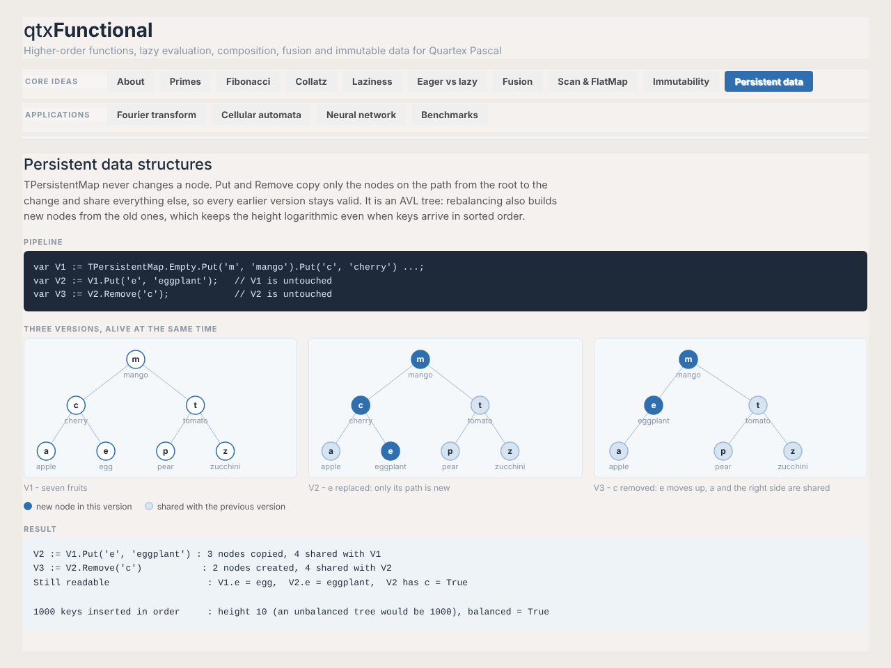
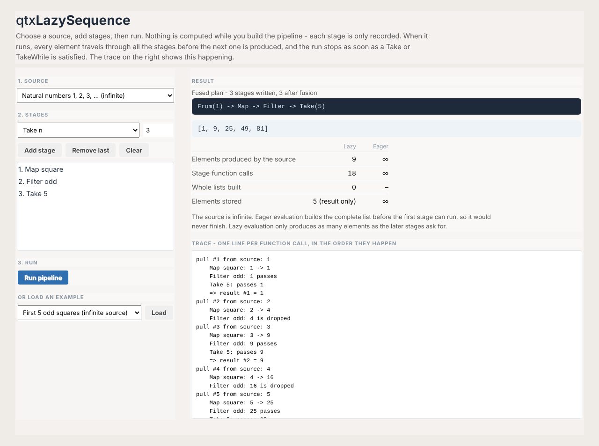
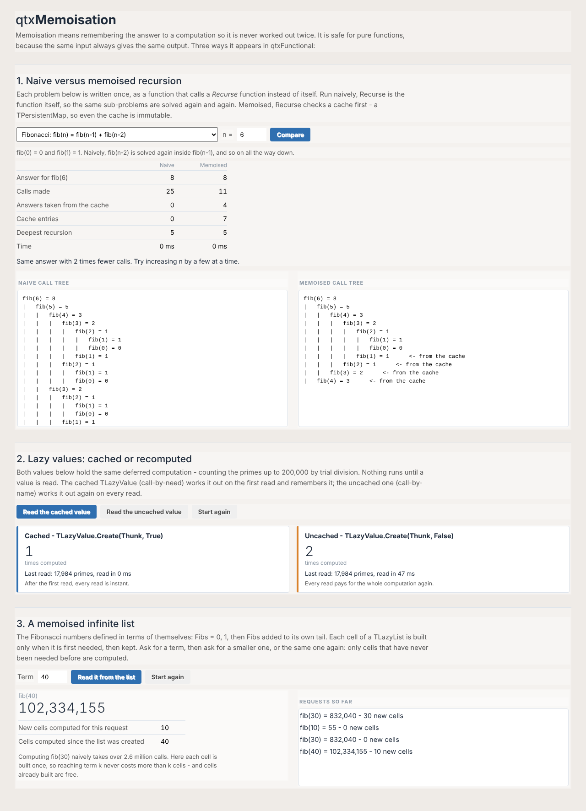
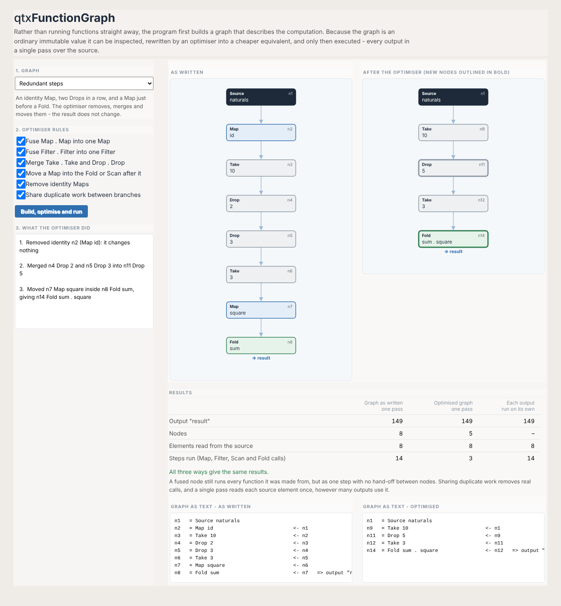

# qtxFunctional — library and demonstrations guide

qtxFunctional is a general-purpose functional programming framework for
[Quartex Pascal](https://quartexdeveloper.com/). It takes its model from
functional languages such as Haskell — in particular the ideas behind Hackage's
*Friday* library — and expresses them in ordinary Object Pascal:

1. **Higher-order functions** — functions that take or return other functions.
2. **Lazy evaluation** — nothing is computed until a result is needed.
3. **Function composition** — building new functions from existing ones.
4. **Fusion** — merging several processing steps into one.
5. **Immutable data** — values that never change once created.

Everything is pure Object Pascal with no inline JavaScript. The library depends
only on `qtx.sysutils`, so it runs in the browser and under Node.js alike.

This guide has three parts: [what the library does](#part-1--the-library),
[what the demonstrations show](#part-2--the-demonstrations), and
[how the repository is organised](#part-3--working-with-the-repository).

---

## Part 1 — The library

### A note on types

Quartex Pascal has no generics, so the library works in two ways:

- **Typed toolkits** for the commonest cases: `Integer` (`TFunction`,
  `TLazyInteger`) and `Float` (`TFloatFunction`, `TVector`).
- **`Variant` for everything else.** A `Variant` can hold a number, a string, a
  record-like object or a class instance, so `TSequence`, `TLazy`, `TLazyList`
  and the graph engine work with any kind of value. *Lift* helpers turn the
  typed functions into Variant ones, for example
  `TVarFunction.Lift(TFunction.Square)`.

### Units at a glance

| Unit | Main types | Purpose |
|---|---|---|
| `functional.functions` | `TFunction`, `TVarFunction` | Function factories, composition, predicates, reducers, lifting |
| `functional.floats` | `TFloatFunction` | The same toolkit for `Float` values |
| `functional.fn` | `TFn`, `TValueFunction` | Named, composable function objects; functions over records and objects |
| `functional.lazy` | `TLazy` / `TLazyValue` | A deferred value, cached or recomputed |
| `functional.lazylist` | `TLazyList` | A lazy linked list that can be infinite and self-referential |
| `functional.fusion` | `TFusion` | The engine that merges pipeline stages and runs them in one pass |
| `functional.sequence` | `TSequence` | General-purpose lazy, immutable, fused streams |
| `functional.lazyinteger` | `TLazyInteger` | A typed integer stream: Map, Filter, Take, Fold |
| `functional.eager` | `TEagerInteger` | A deliberately eager version, for comparison |
| `functional.stats` | `TFunctionalStats` | Counters for objects, arrays and source elements |
| `functional.collections` | `TImmutableList`, `TPersistentMap` | Persistent data structures with structural sharing |
| `functional.vector` | `TVector`, `TMatrix` | Immutable vectors and matrices |
| `functional.fft` | `TFourier`, `TComplexOps` | Fourier transforms written as pure functions |
| `functional.automata` | `TAutomaton` | Elementary cellular automata as lazy sequences |
| `functional.neural` | `TNetwork` | A small neural network trained functionally |
| `functional.graph` | `TGraphNode`, `TFunctionGraph` | Inspectable, optimisable computation graphs |

### 1. Higher-order functions and composition

`TFunction` returns functions as values. Nothing in it holds mutable state, so
every function can be shared and reused.

```pascal
var Inc   := TFunction.Add(1);         // x -> x + 1   (partial application)
var Twice := TFunction.Multiply(2);    // x -> x * 2

TFunction.Compose(Inc, Twice)(5);      // Inc(Twice(5)) = 11
TFunction.AndThen(Inc, Twice)(5);      // Twice(Inc(5)) = 12
```

It also provides predicates (`IsEven`, `IsOdd`, `GreaterThan`), predicate
combinators (`Negate`, `Both`) and reducers for folding (`Sum`, `Product`,
`Maximum`). `TFloatFunction` does the same for floating-point values, with
extras such as `Polynomial`, `Root` and `Reciprocal`.

**`TFn`** wraps a function together with a readable name, so composed functions
can describe themselves. `TFn.Compose(F, G)` means *F(G(x))* and is named
`"F . G"`; `Pipeline` composes a list from left to right.

**`TValueFunction`** works on record-like values and objects: `Field` reads a
field, `Where` tests one, and `UpdateField` returns a **changed copy**, leaving
the original untouched.

### 2. Lazy evaluation

#### `TLazy` (also called `TLazyValue`)

A `TLazy` holds a computation, not a result. Nothing runs until `.Value` is
first read.

```pascal
var Total := TLazy.Create(function: Variant
  begin
    Result := TSequence.Range(1, 1000000).Fold(0, TVarFunction.LiftFold(TFunction.Sum));
  end);                     // nothing has run yet

Total.Value;                // computed now...
Total.Value;                // ...and remembered: instant
```

- **Cached** (`Create(Thunk, True)`, the default) runs at most once. This is
  *call-by-need*, as in Haskell.
- **Uncached** (`Create(Thunk, False)`) runs on every read. This is
  *call-by-name*, for values that depend on changing outside state.
- `Map` and `Bind` build new lazy values without forcing the original.
- `EvaluationCount` and `IsEvaluated` make the behaviour visible.

#### `TLazyList`

A linked list whose tail is built only when first needed, and then kept. This
makes it possible to define lists in terms of themselves:

```pascal
// 0, 1, then the list added to its own tail
Fibs := TLazyList.Cons(0, function: TLazyList begin
  Result := TLazyList.Cons(1, function: TLazyList begin
    Result := TLazyList.ZipWith(Fibs, Fibs.Tail, TVarFunction.LiftFold(TFunction.Sum));
  end);
end);

Fibs.Nth(30);   // 832040 — builds 30 cells, where naive recursion makes 2.7 million calls
```

### 3. Lazy sequences and fusion

#### `TSequence`

The general-purpose stream. Building a pipeline only **records** stages; a
terminal operation does the work.

```pascal
TSequence.From(1)                                   // 1, 2, 3, ... (infinite)
  .Map(TVarFunction.Lift(TFunction.Square))
  .Filter(TVarFunction.LiftPredicate(TFunction.IsOdd))
  .Take(5)
  .AsString;                                        // [1, 9, 25, 49, 81]
```

- **Sources:** `Range`, `From`, `Iterate`, `Replicate`, `FromArray`.
- **Lazy stages:** `Map`, `Filter`, `Take`, `Drop`, `TakeWhile`, `Scan`
  (running totals), `FlatMap` (each value becomes a whole sequence).
- **Combining:** `ZipWith` (with a bounded partner) and `ZipWithList` (with a
  pull-based `TLazyList`, which may be infinite).
- **Terminal operations:** `Fold`, `ToArray`, `Count`, `AsString`, plus
  `FoldLazy` and `Head`, which return a `TLazy` so even the final result is
  deferred.
- **Safety:** an infinite sequence must be bounded by `Take` or `TakeWhile`
  before it runs, otherwise it raises `EFunctional` instead of looping forever.
- **Immutability:** every operation returns a new sequence, so one pipeline can
  be branched and re-run freely.

#### `TFusion` — how pipelines are merged

`TFusion` is the engine behind `TSequence`, and it fuses in two ways:

1. **When the pipeline is built**, adjacent compatible stages are rewritten
   into one:

   | Written | Becomes |
   |---|---|
   | `Map f` then `Map g` | `Map (g . f)` |
   | `Filter p` then `Filter q` | `Filter (p and q)` |
   | `Take n` then `Take m` | `Take (min n m)` |
   | `Drop n` then `Drop m` | `Drop (n + m)` |
   | `Map f` then `Scan g` | one `Scan` that applies `f` inside `g` |

2. **When the pipeline runs**, every stage is chained into one function that
   the source feeds directly. There is a single pass with no intermediate
   arrays, and the source stops the moment the last needed value has been
   delivered.

`Describe` shows the fused plan, for example
`Range(1..20) -> Map{x3} -> Filter{x2} -> Take(4){x2}`.

#### `TLazyInteger` and `TEagerInteger`

`TLazyInteger` is a typed integer stream offering Map, Filter, Take and Fold.
`TEagerInteger` offers the same operations done eagerly — each step builds a
whole new array — and `TFunctionalStats` counts the work. On
`Range(1, 100000).Map(square).Filter(even).Take(10).Fold(sum)` both give 1540,
but:

| | Eager | Lazy |
|---|---|---|
| Intermediate arrays | 4 | 0 |
| Elements stored in arrays | 250,010 | 0 |
| Source elements produced | 100,000 | 20 |

### 4. Immutable, persistent data structures

Persistent structures never change after construction. An "update" returns a
new version that **shares** everything it did not change, so every older
version stays valid.

- **`TImmutableList`**: `Cons` is O(1) and reuses the old list as its tail;
  `SetNth` and `Append` copy only what changes. `ToSequence` feeds a list into a
  fused pipeline.
- **`TPersistentMap`**: a String-keyed **AVL tree** with path copying. `Put`
  and `Remove` copy only the nodes on the path to the change, and rebalancing
  rotations build new nodes rather than editing old ones. Inserting 1,000 keys
  in sorted order gives a height of 10, where an unbalanced tree would be 1,000
  deep. `SharedNodes` measures how much two versions share, and `IsBalanced`
  verifies the invariants.

```pascal
var V1 := TPersistentMap.Empty.Put('e', 'egg').Put('m', 'mango');
var V2 := V1.Put('e', 'eggplant');   // V1.Get('e') is still 'egg'
```

### 5. Numerical and scientific applications

- **`TVector` / `TMatrix`**: immutable, built from `Tabulate`, `Map`, `ZipWith`
  and `Fold`. `Dot` is a fused zip-fold that allocates nothing.
- **`TFourier`**: a recursive Cooley–Tukey FFT written as pure functions, plus
  `InverseFFT` and a direct `DFT` to cross-check it. Complex numbers
  (`TComplex`) are value records.
- **`TAutomaton`**: a rule number from 0 to 255 becomes a pure function from
  one generation to the next, and the whole history is
  `TSequence.Iterate(start, Rule(n))`.
- **`TNetwork`**: a 2-4-1 network whose weights live in one immutable
  `TVector`. One training epoch is a pure function from network to network, so
  training is `Iterate(network, Epoch).Drop(3000).Head`. It learns XOR, and its
  weights are identical to those of a conventional, mutable implementation.

### 6. Computation graphs (`functional.graph`)

Instead of running functions straight away, a program first **builds a graph**
describing the computation:

```
Source -> Map(F) -> Map(G) -> Filter(P) -> output
```

Because the graph is an ordinary immutable value, it can be inspected,
transformed and only then executed.

```pascal
var Src    := TGraphNode.Source('naturals', TSequence.From(1));
var Primes := Src.Filter('prime', IsPrime);

var Graph := TFunctionGraph.Create
  .Output('first 10 primes', Primes.Take(10))
  .Output('100th prime',     Primes.Drop(99).Take(1));

var Log: TTextList;
var Fast := Graph.Optimise(TFunctionGraph.AllRules, Log);   // inspect Log
var Run  := Fast.Execute;                                    // one pass
```

- **Nodes:** Source, Map, Filter, Take, Drop, Scan and Fold. A node can feed
  several others, and a graph can have several named outputs.
- **Inspection:** `ToText`, `Nodes`, `NodeCount`, `ConsumerCount`.
- **Optimiser:** each rule can be switched on or off, and every rewrite is
  logged.

  | Rule | Rewrite |
  |---|---|
  | `orMapFusion` | `Map g . Map f` → `Map (g . f)` |
  | `orFilterFusion` | `Filter q . Filter p` → `Filter (p and q)` |
  | `orTakeDrop` | merge `Take . Take` and `Drop . Drop` |
  | `orFoldFusion` | move a `Map` into the `Fold` or `Scan` after it |
  | `orIdentity` | remove identity `Map`s |
  | `orShareWork` | merge identical nodes from different branches |

  A fusion rule only fires when the inner node has a single consumer. If its
  result is also used elsewhere, merging would compute it twice, so the
  optimiser keeps it and says so in the log.
- **Execution:** `Execute` serves every output in **one traversal** of each
  source. Values fan out to every consumer, and the source stops once the last
  output has what it needs. `ExecuteSeparately` runs each output on its own,
  for comparison. Before running, the engine checks that every output will
  finish.
- **Naming rule:** two nodes count as the same work when they have the same
  kind, name, parameters and input. Use one name per function.

---

## Part 2 — The demonstrations

There are five Quartex projects. All of them take the library from the
installed package; none keeps its own copy.

### `tests/qtxFunctional` — the test suite (Node.js)

A console application that checks the whole library: **155 checks**, all
passing. Expected values were computed independently in Python before the
Pascal was written, and the suite ends with a performance table comparing the
functional code with conventional Pascal on the same data.

| Section | What it checks |
|---|---|
| Core | Map, Filter, Take, Fold; laziness; composition; fusion; `TLazy`; `TSequence` |
| Stage 1 | Eager versus lazy work counts |
| Stage 2 | Floats, `TFn`, records and objects |
| Stage 3 | Cached and uncached lazy values; recursive and infinite lists |
| Stage 4 | `TImmutableList` sharing; `TPersistentMap` path copying |
| Extensions | Scan, FlatMap, ZipWith, ZipWithList; AVL balancing |
| Stage 6 | Vectors, matrices, FFT, automata, neural network, benchmarks |

### `demos/qtxFunctionalDemo` — a tour of the whole library

A browser application with 14 pages, each running a real pipeline and showing
its code beside the live result. Charts, trees and grids are inline SVG built in
Pascal.

| Page | What it demonstrates |
|---|---|
| About | An overview of the library |
| Primes | Primes found in an infinite stream; one filter feeds a list and two Folds |
| Fibonacci | `TakeWhile` stops an infinite sequence (Project Euler problem 2) |
| Collatz | `Iterate` produces the sequence; one immutable pipeline reused three times |
| Laziness | A million-element sum computed once on demand; `Head` defers "the 1000th prime" |
| Eager vs lazy | Live counters for the same pipeline run eagerly and lazily |
| Fusion | Seven calls merged into three stages; only 12 elements read from an infinite source |
| Scan & FlatMap | Running totals, Pythagorean triples from nested FlatMap, zipping with an infinite list |
| Immutability | One sequence branched into two pipelines without changing it |
| Persistent data | Three map versions drawn as trees, with new and shared nodes coloured |
| Fourier transform | A spectrum chart and a low-pass filter written as a pure function |
| Cellular automata | Rules 30, 90 and 110 drawn from their lazy histories |
| Neural network | Learning curve, decision maps before and after training, and outputs |
| Benchmarks | Five workloads timed live, with a check that both versions agree |



### `demos/qtxLazySequence` — lazy evaluation, step by step

Built from standard Quartex controls (drop-downs, a number box, buttons, a list
box and a memo). You choose a source, stack up stages and run the pipeline. The
page shows:

- the result and the fused plan;
- a **trace of every function call**, which shows each element travelling
  through all the stages before the next one is produced;
- **lazy versus eager counts**. For an infinite source it explains why eager
  evaluation could never finish.

Six examples are included. In "7 stages become 3", for instance, the lazy
pipeline reads 9 source elements where the eager one builds 8 full lists from
1,000. The page also handles two problem cases: an infinite source with no Take
gets an explanation instead of hanging, and filters that can never pass
together are stopped after 100,000 elements.



### `demos/qtxMemoisation` — remembering results

Three sections, built from standard controls:

1. **Naive versus memoised recursion.** Fibonacci, staircase climbing and grid
   paths are each written once, as *open-recursive* functions that call a
   `Recurse` function handed to them. The same definition then runs naively or
   with a cache, which is a `TPersistentMap`, so even the cache is immutable.
   Call counts, cache hits, time and both call trees are shown side by side.
   For example, `fib(30)` takes 2,692,537 naive calls but only 59 memoised.
2. **Lazy values.** A cached and an uncached `TLazyValue` share one expensive
   computation, showing call-by-need against call-by-name.
3. **A memoised infinite list.** The self-referential Fibonacci `TLazyList`
   reports how many cells each request builds; cells already built are free.



### `demos/qtxFunctionGraph` — the computation graph

The goal of the project: build a graph, inspect it, optimise it and execute it.
Seven preset graphs are drawn before and after optimisation, with nodes created
by a rewrite outlined in bold. Checkboxes switch each optimiser rule on or off;
a log explains every rewrite; and a results table compares the graph as
written, the optimised graph, and each output run on its own.

| Preset | What it shows |
|---|---|
| The pipeline from the notes | Map, Map, Filter: 4 nodes become 3, and 30 steps become 20 |
| Two outputs, one pass | One filtered stream feeds two Folds: 100 source reads instead of 200 |
| Duplicate work | Two branches compute the same Map; the optimiser shares one node |
| A shared step blocks fusion | The optimiser declines to fuse a node used twice, and says why |
| Redundant steps | Identity removed, Drops merged, Map moved into Fold: 8 nodes become 5 |
| Infinite source, three outputs | Primes feed three outputs; the source stops at 541 reads instead of 667 |
| An output that would never finish | The engine refuses to run it, because the graph can be checked first |



---

## Part 3 — Working with the repository

### Layout

```
src/                 The library: 16 functional.*.pas units (the source of truth)
package/             qtxFunctional.pkg and its package.info.json manifest
tools/               build-package.py — rebuilds the package from src/
tests/qtxFunctional  The Node.js test suite (155 checks)
demos/               qtxFunctionalDemo, qtxLazySequence, qtxMemoisation, qtxFunctionGraph
docs/                This guide and its screenshots
```

### Installing the package

1. Copy `package/qtxFunctional.pkg` into `%APPDATA%\qtx\packages`.
2. Restart the Quartex Pascal IDE. Packages are only read at start-up.
3. Add the units you need to a `uses` clause, for example `functional.sequence`.

The package targets `universal` (browser and Node.js) and depends on RTL System
1.2.0.0 or later.

### Opening the projects

Copy a folder from `tests/` or `demos/` into your Quartex projects folder and
open it in the IDE. Compiled output (`index.js`) is not stored in the
repository; the IDE rebuilds it when the project is compiled.

### Changing the library

1. Edit the units in `src/`.
2. Run `python tools/build-package.py 1.2.0.0 "What changed"` to set the new
   version and rebuild the package.
3. Install the new `.pkg` as above and restart the IDE.
4. Run the test suite, then check the demos.

### Known limitations

- **`Variant` for general values.** Without generics, sequences, lazy values and
  graphs carry `Variant`, so type errors are found at run time rather than
  compile time.
- **Zipping two push sequences.** A push source cannot be paused, so `ZipWith`
  reads its partner fully first, and the partner must be bounded. Use
  `ZipWithList` with a `TLazyList` for an infinite partner.
- **Benchmark timing.** Times are measured with `Now`, which has millisecond
  resolution, so ratios for short runs vary from run to run.
- **Graph node identity.** The optimiser treats nodes with the same kind, name,
  parameters and input as the same work, so each name must stand for one
  function.
